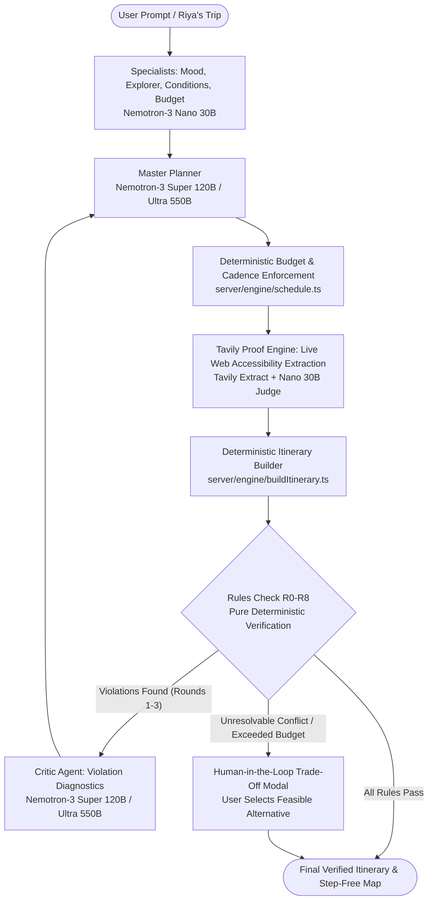

# TravelVerse 🧭

> **Self-Correcting Travel Agent for High-Stakes Constraints**  
> *Built with NVIDIA Nemotron on Nebius Token Factory for the Nebius x NVIDIA Hackathon (Best Apps & Agents).*

[](https://travelers-taupe.vercel.app)
[](https://github.com/ParNet-commits/travelers)
[](./LICENSE)
[](https://nebius.com/token-factory)
[](https://build.nvidia.com)

---

## 🌟 TravelVerse in One Paragraph

TravelVerse is a self-correcting multi-agent travel planner designed for high-stakes, real-world constraints where generic LLM hallucinations fail travelers. In our hero scenario, Riya needs to plan a 4-day, $900 30th anniversary trip to Udaipur for her parents, where her father strictly cannot climb stairs due to a knee injury. While conventional AI travel bots recommend scenic hill-forts with steep steps and hallucinate budget totals, TravelVerse combines creative reasoning from NVIDIA Nemotron models on Nebius Token Factory with a pure deterministic physics & finance engine that mathematically guarantees real-world feasibility.

- 🌐 **Live Demo:** [https://travelers-taupe.vercel.app](https://travelers-taupe.vercel.app)
- 📺 **3-Minute Video Walkthrough:** [Watch 3-minute demo video](https://youtube.com) <!-- replace with final video URL -->
- 🛠️ **Control Room (Admin Telemetry):** [https://travelers-taupe.vercel.app/control](https://travelers-taupe.vercel.app/control)

---

## 🔄 How It Works



### Core Architecture Highlights

1. **LLM Decides, Code Computes:**  
   Language models output **only** semantic IDs, enums, short rationale text, and range-checked decision indices. Every single monetary price, travel arrival time, walking distance, currency exchange, budget total, and pass/fail constraint is computed deterministically in `server/engine/*`. Never does an LLM hallucinate or compute money or physics.
2. **Rules R0–R8 (The Deterministic Guardrails):**  
   Nine deterministic checks run in zero milliseconds to validate every itinerary draft:
   - **R0 (Dates & Pace):** Non-overlapping chronological events, reasonable stops per day.
   - **R1 (Budget Ceiling):** Total integer minor units (cents) must stay within user budget.
   - **R2 (Transit Feasibility):** Real OSRM driving and walking times between coordinates.
   - **R3 (Mobility & Step-Free):** Zero stairs, verified ramps/elevators when mobility constraint is active.
   - **R4 (Opening Hours & Closures):** Respects venue hours, avoids closed days.
   - **R5 (Rest & Meal Rhythm):** Paces breakfast, lunch, dinner, and adequate rest buffers.
   - **R6 (Lodging Continuity):** One lodging base per city leg, avoiding unnecessary room changes.
   - **R7 (Geo-Clustering):** Groups nearby attractions to prevent criss-crossing the city.
   - **R8 (Weather Suitability):** Routes indoor venues during heavy rain or excessive midday heat.
3. **Critic + Enforcement Loop:**  
   When a rule is violated (e.g. City Palace has steep stairs), the deterministic engine first attempts direct mathematical repair (`repairToFit`). If unresolvable, the **Critic Agent** pinpoints the exact failure, builds structured repair feedback, and passes it to the **Planner** for an intelligent re-plan (bounded to max 3 re-plans, escalating to Nemotron Ultra on round 3).
4. **Tavily Proof Engine:**  
   Autonomous accessibility verification combines Tavily Search and Extract to pull live official venue markdown, submits it to a Nemotron Nano judge, and cryptographically checks verbatim quotes (`verifyVerbatimQuote`) so users see indisputable proof of ramp or elevator access.
5. **Human-in-the-Loop Trade-Off:**  
   When constraints are mathematically incompatible (e.g., $150 budget for 4 days in a heritage destination), TravelVerse refuses to fake numbers. It halts the stream and presents explicit trade-off choices with transparent impact deltas.

---

## ⚡ Nemotron on Nebius Token Factory

TravelVerse leverages a multi-tiered hierarchy of NVIDIA Nemotron models hosted on the high-throughput [Nebius Token Factory](https://nebius.com/token-factory):

| Agent Role | Model ID | Tier / Role | Parameter Size | Primary Responsibility |
|---|---|---|---|---|
| **Specialists** (Mood, Explorer, Conditions, Budget) | `nvidia/NVIDIA-Nemotron-3-Nano-30B-A3B` | Fast | 30B | Parallel discovery of vibe, venue candidates, live weather, and budget buckets. |
| **Accessibility Judge** (Tavily Proof) | `nvidia/NVIDIA-Nemotron-3-Nano-30B-A3B` | Fast | 30B | Evaluates scraped venue text to extract step-free access evidence. |
| **Master Planner** (Rounds 1 & 2) | `nvidia/nemotron-3-super-120b-a12b` | Planner | 120B | Multi-day structural scheduling, venue sequencing, and dining selection. |
| **Critic Agent** (Rounds 1 & 2) | `nvidia/nemotron-3-super-120b-a12b` | Critic | 120B | Diagnoses constraint violations and formulates actionable re-plan instructions. |
| **Escalation Planner & Critic** (Round 3) | `nvidia/Nemotron-3-Ultra-550b-a55b` | Escalation | 550B | Deep multi-constraint reconciliation when earlier rounds fail. |

### Technical Integration Details

- **OpenAI-Compatible Endpoint:**  
  Standardized HTTP/SSE client using `https://api.tokenfactory.nebius.com/v1/chat/completions` with bearer authentication.
- **Strict Structured JSON Mode:**  
  All planning calls enforce `response_format: { type: "json_object" }` validated through comprehensive Zod schemas in `types/travelverse.ts`.
- **Reasoning Tokens & Thinking Management:**  
  Nemotron reasoning behavior is handled with explicit token budgeting and `chat_template_kwargs: { enable_thinking: false }` fallback to prevent reasoning tokens from exhausting `max_tokens` allocations.
- **Measured Latency & Throughput** *(from [bench-report.md](./bench-report.md))*:
  - **Nano 30B:** TTFT p50 **273 ms**, Stream Total p50 **936 ms**, Output **187.5 tok/s**. Concurrency: 5/5 parallel calls completed in 2004 ms.
  - **Super 120B:** TTFT p50 **1637 ms**, Stream Total p50 **2380 ms**, Output **159.6 tok/s**.
  - **Ultra 550B:** TTFT p50 **552 ms**, Non-stream p50 **568 ms**, Output **314.0 tok/s** (9x faster non-stream than 120B!).
- **Cost Efficiency** *(from [eval-report.md](./eval-report.md))*:
  - Riya hero plan (full 3-round escalation): **$0.0465** total model spend.
  - Couple balanced plan: **$0.0074** total model spend.
  - Average cost per plan: **$0.0068** (< 1 cent!).

---

## 🔍 Tavily Search & Extract Integration

TravelVerse integrates Tavily for live grounding and verifiable physical accessibility:

- **Tavily Search:** Real-time discovery of city-wide festivals, holiday venue closures, and sudden weather alerts.
- **Tavily Extract (Accessibility Proof Engine):**  
  Pulls raw DOM/markdown from venue official domains (e.g., City Palace, Jagmandir, Saheliyon Ki Bari) to verify wheelchair ramps, elevators, and step-free entrances.
- **Credit Footprint:** ~2 Tavily requests (1 search + 1 extract) per standard plan, strictly bounded by a cap of **8 Tavily credits per run** in `RunBudget`.

---

## 🛡️ Reliability & Safety

- **Deterministic Hard Caps (`RunBudget`):**  
  Every execution is bounded by immutable resource caps:
  - Max **3 re-plans**
  - Max **10 LLM calls**
  - Max **8 tool calls**
  - Max **60,000 tokens**
  - Max **$0.10 USD spend** per plan
  - **240-second wall-clock deadline**
  - Rate limiting: **6 runs per IP per hour**
- **Deterministic Fallbacks:**  
  Every LLM step has a pure mathematical fallback (`greedyDraft`, `repairToFit`). The agent loop `runPlan` never throws unhandled exceptions.
- **Three-Tier Replay System:**  
  1. *Tier 1:* Instant client golden replay (`riya.ts`).  
  2. *Tier 2:* Server-side cached event replay stream.  
  3. *Tier 3:* Offline deterministic engine synthesis.  
  *Rule:* Replays are **always** visibly badged with a non-dismissible amber replay banner; replays are never presented as live.
- **Prompt Injection Defense:**  
  External map text and search results are sanitized through `sanitizeExternalText`, checked via `detectInjection`, and isolated in `<untrusted_content>` tags before prompt injection.
- **Zero Browser Secrets:**  
  No secrets exist in the client. Strict pre-commit and CI scans (`scripts/check-secrets.mjs`) prevent accidental leaks.
- **Test Suite & Evaluation:**  
  - **65 passing automated tests** across 9 test suites (`engine`, `safety`, `rules`, `orchestrator`, `llm`, `udaipur`, `proof-and-client`, etc.).
  - Mini-eval across 10 adversarial scenarios: 0 crashes, 0 unhandled exceptions.

---

## 💻 Running Locally

### Prerequisites
- Node.js >= 22
- npm >= 10

### 1. Clone & Install Dependencies
```bash
git clone https://github.com/ParNet-commits/travelers.git
cd travelers
npm install
```

### 2. Configure Environment Variables
Copy `.env.example` to `.env.local` and add your API keys:
```bash
cp .env.example .env.local
```

#### Environment Variables Reference

| Variable | Required | Description |
|---|---|---|
| `NEBIUS_API_KEY` | **Yes** | Nebius Token Factory API key for NVIDIA Nemotron inference |
| `TAVILY_API_KEY` | **Yes** | Tavily API key for real-time web search and accessibility extraction |
| `TV_ADMIN_TOKEN` | **Yes** | Secret bearer token for Control Room administrative actions (`/control`) |
| `TV_CONTACT_EMAIL` | **Yes** | Contact email included in User-Agent header for OpenStreetMap / Nominatim |
| `TV_MODEL_FAST` | No | Fast tier model ID (default: `nvidia/NVIDIA-Nemotron-3-Nano-30B-A3B`) |
| `TV_MODEL_PLANNER` | No | Planner tier model ID (default: `nvidia/nemotron-3-super-120b-a12b`) |
| `TV_MODEL_ESCALATION` | No | Escalation tier model ID (default: `nvidia/Nemotron-3-Ultra-550b-a55b`) |
| `TV_MODEL_ALLOWLIST` | No | Comma-separated list of allowed models switchable in Control Room |
| `TV_JSON_MODE` | No | JSON mode configuration (`json_object`, `json_schema`, or `none`) |
| `TV_LIVE_ENABLED` | No | Master kill switch (set `false` to force replay mode and zero spend) |
| `TV_MAX_USD_PER_RUN` | No | Maximum allowed USD expenditure per run (default: `0.10`) |
| `TV_RUNS_PER_IP_PER_HOUR` | No | IP rate limiting threshold (default: `6`) |
| `TV_REPLAY_SPEED` | No | Playback speed multiplier for replay streams (default: `1.5`) |

### 3. Launch Development Servers

Start the local API backend server in Terminal 1 (runs on port 8787):
```bash
npm run dev:api
```

Start the Vite React frontend in Terminal 2 (runs on port 5173):
```bash
npm run dev
```

Open [http://localhost:5173](http://localhost:5173) in your browser.

---

## 📜 Available Scripts

| Script | Command | Purpose |
|---|---|---|
| `npm run dev` | `vite` | Starts Vite client dev server (proxies `/api` to local API) |
| `npm run dev:api` | `tsx scripts/dev-server.ts` | Starts local Node.js API server on port 8787 |
| `npm run build` | `tsc -p tsconfig.server.json && tsc -b && vite build` | Compiles server TypeScript and creates production bundle |
| `npm run preview` | `vite preview` | Previews production client build locally |
| `npm run typecheck` | `tsc -p tsconfig.server.json && tsc -b` | Strict TypeScript verification across server and client |
| `npm run test` | `vitest run` | Runs complete 65-test Vitest test suite |
| `npm run lint` | `oxlint` | Runs fast Oxlint code quality checks |
| `npm run check:secrets` | `node scripts/check-secrets.mjs` | Scans codebase and bundle for exposed API keys |
| `npm run check:data` | `tsx scripts/check-data.ts` | Validates curated city packs, domains, and pricing |
| `npm run check` | `npm run typecheck && npm run test && npm run check:data && npm run check:secrets` | Complete pre-deploy CI verification suite |
| `npm run probe:models` | `tsx scripts/probe-models.ts` | Probes Nebius Token Factory model capabilities |
| `npm run smoke:tools` | `tsx scripts/smoke-tools.ts` | Tests external tool connectors (Tavily, OSRM, Meteo) |
| `npm run record:golden` | `tsx scripts/record-golden.ts` | Records a live run into a deterministic golden replay |
| `npm run bench` | `tsx scripts/benchmark-token-factory.ts` | Measures TTFT, throughput, and concurrency across models |
| `npm run eval` | `tsx scripts/eval-mini.ts` | Evaluates agent behavior across 10 test scenarios |
| `npm run run:once` | `tsx scripts/run-once.ts` | Executes a single headless planning run from CLI |

---

## 🏆 Hackathon Submission & Documentation

Built during the **Nebius x NVIDIA Hackathon (2026)** for the *Best Apps & Agents* track.

- 📄 **Devpost Submission Overview:** Read our full submission story in [docs/devpost.md](./docs/devpost.md).
- 📝 **Token Factory Developer Experience Log:** Read our candid DX feedback in [docs/feedback-notes.md](./docs/feedback-notes.md).
- 📊 **Benchmark Results:** Read the Token Factory latency and concurrency benchmark in [bench-report.md](./bench-report.md).
- 🧪 **Evaluation Results:** Read the 10-scenario agent evaluation breakdown in [eval-report.md](./eval-report.md).

---

## 📄 License

This project is licensed under the MIT License — see the [LICENSE](./LICENSE) file for details.  
Copyright (c) 2026 Paras Neta.
